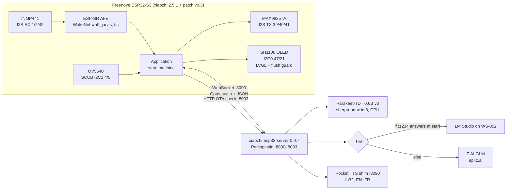

# xiaozhi voice satellite — Freenove ESP32-S3 WROOM CAM

**Version:** 1.0
**Last updated:** 2026-10-19
**Owner:** Jérôme Martin (YokohamaAIart)
**Stack:** ESP-IDF v6.1 · xiaozhi-esp32 2.5.1 (`78/xiaozhi-esp32` @ `ed5cd7b`) · xiaozhi-esp32-server 0.9.7 (Python 3.10, uv) · Kyutai Pocket TTS shim (Python 3.12) · Parakeet-TDT 0.6B v3 ASR (sherpa-onnx int8) · Z.AI GLM (fallback LLM) / LM Studio on WS-002 (primary when up)
**Status:** Draft — hardware bring-up; everything verified except the speaker amplifier output (module diagnosed dead 2026-10-19, replacement pending)
**Companion:** `XIAOZHI_S3_CHEATSHEET_v1.0.md` · `freenove-s3-xiaozhi-handoff-v1.5.md` (session state and gates)

## Table of contents

- [1. Overview](#1-overview)
- [2. Status](#2-status)
- [3. Architecture and infrastructure map](#3-architecture-and-infrastructure-map)
- [4. Logic walkthrough](#4-logic-walkthrough)
- [5. Configuration reference](#5-configuration-reference)
- [6. Prompts catalogue](#6-prompts-catalogue)
- [7. Usage guide](#7-usage-guide)
- [8. Hints and gotchas](#8-hints-and-gotchas)
- [9. Glossary](#9-glossary)

## 1. Overview

A LAN-only voice assistant: a Freenove ESP32-S3 WROOM CAM board with an I²S microphone, an I²S class-D amplifier, a 1.3″ I²C OLED and the on-board OV5640 camera runs the open-source xiaozhi firmware with the "Jarvis" wake word; it talks over WebSocket to a xiaozhi-esp32-server instance on Perlinpinpin (bare-metal Xubuntu box, `192.168.1.6`) that does ASR, LLM and TTS locally or via Z.AI. No cloud account, no VPS, no port forwarding — the operator's non-negotiable constraint. Operated by one person from the bench; the end result is a French/English spoken conversation with a face and status on the OLED.

The repository `YokohamaAIart/AI_chatbot_esp32` is the documentation and tooling side of the project (handoffs, firmware patches, wiring diagrams, the `wiring-diagram` skill). The firmware tree and the server tree live on Perlinpinpin and are not in this repo.

## 2. Status

| Area | State | Evidence (2026-10-18/19) |
|---|---|---|
| Wiring | ✅ verified pin by pin on hardware (`freenove-s3-wiring-diagram-v0.7`) | silkscreens read on the modules; unpowered rail/pair reads OL; OUT+↔OUT− 7.5 Ω through the speaker |
| Display (SH1106 I²C) | ✅ patch v0.3: boots, correct orientation, survives I²C NACKs | `OLED 128x64 on I2C port 0`; guard logs `I2C flush lost, forcing flush_ready` instead of freezing |
| Camera | ✅ | `Detected OV5640 camera`, `cam config ok` |
| Wi-Fi → server | ✅ | IP in 8 s; OTA check against `192.168.1.6:8003` passes |
| Wake word + mic → ASR | ✅ | `AFE: WakeNet(wn9_jarvis_tts)`; server `识别文本:` shows what was said |
| LLM reply language | ✅ English/French (no more Chinese) | `language:` key under PocketTTS in `data/.config.yaml` |
| TTS | ✅ Pocket TTS fp32 | `语音生成成功`, audio sent |
| **Speaker output** | ❌ **MAX98357A module dead** | clocks, data, SD > 1.4 V and 5 V all present at the pads; outputs parked at 3.4 V; 0 V AC into the speaker while speaking |
| Clock on OLED | ⚠️ shows UTC+8 | server `timezone_offset` still at the Chinese default [VERIFY key name on 0.9.7] |

Open: replace the amp (same part, re-verify silkscreen order), hardware pull-ups/cap on the OLED bus (software guard covers it meanwhile), server time zone.

## 3. Architecture and infrastructure map

### 3.1 Repository (this repo)

```
AI_chatbot_esp32/
├── CLAUDE.md                                  # Agent working rules for the docs repo (versioning, never push unasked)
├── README.md
├── docs/
│   ├── INDEX.md                               # Doc index (which version is current)
│   ├── links.md
│   ├── research/esp32-family-llm-companion-v1.0.md
│   ├── xiaozhi-e32r28t/                       # Sister project: LCDWiki E32R28T board (no mic, no PSRAM) — handoff + SOP
│   └── xiaozhi-freenove-s3/                   # THIS project
│       ├── XIAOZHI_S3_PROJECT_DOC_v1.0.md     # this file
│       ├── XIAOZHI_S3_CHEATSHEET_v1.0.md      # one-page operator reference
│       ├── freenove-s3-xiaozhi-handoff-v1.5.md# session state, gates, next steps (v1.2–v1.4 kept for history)
│       ├── freenove-s3-wiring-diagram-v0.7.{json,svg,pdf,png}  # VERIFIED as-built wiring (spec + renders)
│       ├── s3cam-oled-i2c-v0.3.patch          # firmware patch vs ed5cd7b: I²C OLED instead of SPI LCD + LVGL flush guard
│       ├── gc9a01-xiaozhi-firmware-params-v1.1.md # the shelved round-display path (kept for reference)
│       └── xiaozhi-s3cam-CLAUDE.md            # copy of ~/xiaozhi-s3cam/CLAUDE.md (firmware-tree agent rules)
├── tools/
│   ├── wiring-diagram/                        # the `wiring-diagram` skill: SKILL.md, wiring_diagram.py (JSON spec → SVG/PDF/PNG), references/, examples/
│   └── xiaozhi-folder-push.sh                 # plan|clean|push|apply|restore for the docs folder (secret/archive filters)
├── xiaozhi-e32r28t-handoff/                   # E32R28T bundle incl. the SERVER SCRIPTS reused here:
│   ├── server/setup-server.sh                 #   bare-metal install: two uv venvs, Parakeet + Pocket TTS from HF, two upstream patches
│   ├── server/start.sh                        #   LLM auto-select (LM Studio on WS-002 else $FALLBACK_LLM), Pocket TTS shim, app.py
│   ├── server/pocket_tts_openai.py            #   OpenAI-compatible /v1/audio/speech shim over Kyutai Pocket TTS (EN+FR, voice "auto")
│   └── server/patch-parakeet.py               #   adds nemo_transducer (Parakeet) to SherpaASR
├── xiaozhi-save.sh / xiaozhi-save-status-v1.0.md  # earlier folder-save tooling
└── LICENSE
```

### 3.2 Hosts and trees (outside the repo)

| Host | Path | Role |
|---|---|---|
| Perlinpinpin `192.168.1.6` (user `hackinblue`) | `~/xiaozhi-s3cam` | firmware tree, branch `freenove-s3` on `4c09662` (= upstream `ed5cd7b` + snapshot) + patch v0.3 applied. **Path must have no spaces** |
| Perlinpinpin | `~/xiaozhi-esp32-server` → symlink → `~/Documents/Microcontrolers/Xiao Zhi/xiaozhi-esp32-server` | server tree; `main/xiaozhi-server/` holds `app.py`, `.venv` (py3.10), `data/.config.yaml`, `tmp/server.log` |
| Perlinpinpin | `~/pocket-tts` | Pocket TTS venv (py3.12) + `pocket_tts_openai.py`, `shim.log` |
| Perlinpinpin | `~/projects/xiaozhi-e32r28t/server/start.sh` | the **live** start script (`--quantize` removed). The copy under `~/Documents/.../docs/xiaozhi-e32r28t-handoff/` is the untouched handoff version |
| Perlinpinpin | `~/Documents/Microcontrolers/Xiao Zhi/` | local clone of this repo |
| Perlinpinpin | `~/esp/esp-idf` | ESP-IDF v6.1 (`. ~/esp/esp-idf/export.sh`) |
| WS-002 (Windows) | LM Studio `:1234` | optional primary LLM; `start.sh` probes it at launch only |
| Board | MAC `20:6e:f1:aa:b5:6c`, DHCP hostname `Xiaozhi-B56C` | serial via the **UART** USB-C (CH343 → `/dev/ttyACM0`) |

### 3.3 Hardware (as built, diagram v0.7)

| Module | Pins (silkscreen order) | Board GPIO | Notes |
|---|---|---|---|
| Freenove ESP32-S3 WROOM CAM (FNK0085) | 5V · 3V3 · GND (single) · GPIO header | — | 16 MB flash, 8 MB octal PSRAM, OV5640 on FPC (GPIO 4–13, 15–18), microSD on 38/39/40 (slot stays empty) |
| INMP441 I²S mic (round breakout) | pad side 2×3: `L/R · WS · SCK` / `GND · VDD · SD` | WS 1 · SCK 2 · SD 42 · L/R→GND · VDD 3V3 | L/R→GND = left slot; mic port on the other face |
| MAX98357A I²S amp (purple clone) | `LRC · BCLK · DIN · GAIN · SD · GND · VIN` | LRC 41 · BCLK 40 · DIN 39 · VIN 5V | GAIN NC = 9 dB; SD NC = (L+R)/2 via on-board 1 MΩ (`105`) pull-up; terminal block removed, speaker wires soldered through its holes (⊕ left, ⊖ right) |
| Speaker | ⊕ / ⊖ | — | replacement after an open coil; marking not read; 7.5 Ω measured |
| SH1106 1.3″ OLED I²C | `VCC · GND · SCK · SDA` | SDA 47 · SCL 21 · VCC 3V3 | address 0x3C, I²C port 0 at 100 kHz; monochrome |
| Status LED / BOOT | GPIO 48 (WS2812) / GPIO 0 | — | blue `IO2` LED = I²S mic clock running |

Supplies: GND star at the board's single GND pin; 3V3 Y-split to mic VDD and OLED VCC; amp VIN on 5V.

### 3.4 Component diagram



### 3.5 Data flow

Mic PCM 16 kHz → AFE (wake word, VAD) → Opus → WebSocket → server ASR (Parakeet) → LLM (persona prompt + MCP tools exposed by the board) → TTS (Pocket) → Opus → board decode → I²S TX → amp → speaker. OLED shows status bar (Wi-Fi, server, battery, time), emotion face and the current sentence.

## 4. Logic walkthrough

1. **Boot** (`main.cc` → `Application::Initialize`). Board class `CompactWifiBoardS3Cam` constructor: with `CONFIG_S3CAM_DISPLAY_OLED_I2C=y` it runs `InitializeDisplayI2c()` + `InitializeOledDisplay()` (patch) instead of the SPI LCD path; then buttons, camera (`esp_camera_init`, SCCB on I²C port 1), optional backlight (NC here).
2. **Display** — `esp_lcd_new_panel_io_i2c` (0x3C, 100 kHz) → `esp_lcd_new_panel_sh1106` → `OledDisplay` → `lvgl_port_add_disp`. Patch v0.3 registers an LVGL `flush_wait_cb`: a healthy I²C flush completes synchronously, so the callback only runs when a transfer was NACKed and `on_color_trans_done` never came; after ~100 ms it forces `lv_display_flush_ready`. Without it the LVGL task spins in `wait_for_flushing`, holds the display lock, `DisplayLockGuard` times out after 30 s, and the whole state machine stalls (observed 2026-10-18).
3. **OTA/activation** — `StateMachine: starting → activating`; HTTP GET to `CONFIG_OTA_URL` (`http://192.168.1.6:8003/xiaozhi/ota/`); the server replies "latest" and hands out the WebSocket config; → `idle`.
4. **Wake** — AFE detects "Jarvis" (or BOOT button short press toggles chat) → WebSocket to `:8000` → `listen` → mic Opus streams.
5. **Server turn** — ASR text (`识别文本:`), LLM call (persona + MCP tool list from the board: `get_device_status`, `set_volume`, `set_theme`, `take_photo`), TTS per sentence (`语音生成成功`), audio frames back (`发送第一段语音`).
6. **Playback** — board decodes Opus → `NoAudioCodecSimplex` I²S TX (DIN 39, BCLK 40, LRC 41) at the stored volume (NVS, default 70; now 100) → amp. Where the chain currently stops: the amp receives everything and outputs nothing.
7. **Error branches** — Wi-Fi fail → provisioning hotspot (`CONFIG_USE_HOTSPOT_WIFI_PROVISIONING=y`); server down → cloud icon `[CONNECT]`, solid blue status LED [VERIFY colour map]; I²C NACK → guard; camera SCCB and OLED must not share an I²C port (port 1 is the camera's).

## 5. Configuration reference

### 5.1 Firmware build (`main/boards/bread-compact-wifi-s3cam/config.json` → `sdkconfig_append`)

| Key | Value | Required | Description |
|---|---|---|---|
| `CONFIG_S3CAM_DISPLAY_OLED_I2C` | `y` | Yes (this build) | Patch Kconfig: I²C OLED path, SPI LCD compiled out |
| `CONFIG_OLED_SH1106_128X64` | `y` | Yes | OLED type (alternatives `CONFIG_OLED_SSD1306_128X64/128X32`) |
| `CONFIG_OTA_URL` | `"http://192.168.1.6:8003/xiaozhi/ota/"` | Yes | LAN server; runtime value lives in NVS after first OTA |
| build.py args | `--language en-US --wake-word wn9_jarvis_tts` | Yes | UI language, wake word model |
| `build_options.camera_hmirror/vflip` | `false` | No | camera orientation |

`scripts/build.py` regenerates `sdkconfig` from this file on every run; never edit `sdkconfig` or use menuconfig for persistent changes.

### 5.2 Firmware defines (patch v0.3, `config.h`, inside `#ifdef CONFIG_S3CAM_DISPLAY_OLED_I2C`)

| Define | Value | Notes |
|---|---|---|
| `DISPLAY_I2C_PORT` | `I2C_NUM_0` | port 1 belongs to the camera SCCB |
| `DISPLAY_SDA_PIN` / `DISPLAY_SCL_PIN` | 47 / 21 | former LCD DC/RST pins |
| `DISPLAY_WIDTH` / `DISPLAY_HEIGHT` | 128 / 64 | from the OLED Kconfig choice |
| `DISPLAY_MIRROR_X` / `_Y` | `false` / `false` | upright on this mounting; `true/true` = 180° |
| `scl_speed_hz` (`compact_wifi_board_s3cam.cc`) | 100 kHz | down from 400 kHz |
| `DISPLAY_BACKLIGHT_PIN` | `GPIO_NUM_NC` | OLED has none |
| Audio (unchanged upstream) | mic WS/SCK/SD 1/2/42 · spk DIN/BCLK/LRC 39/40/41 | `NoAudioCodecSimplex` |

### 5.3 Server (`~/xiaozhi-esp32-server/main/xiaozhi-server/data/.config.yaml`, not in the repo — secrets)

| Key | Value here | Description |
|---|---|---|
| `selected_module.LLM` | rewritten by `start.sh` to `LMStudioLLM` or `$FALLBACK_LLM` (`ZaiGLMLLM` default, `DeepSeekLLM` optional) | LLM provider |
| `selected_module.ASR` | `ParakeetASR` (SherpaASR + `nemo_transducer` patch) | local ASR |
| `selected_module.TTS` | `PocketTTS` (`type: openai`, URL `http://127.0.0.1:8090/v1/audio/speech`) | local TTS |
| `TTS.PocketTTS.language` | `"the language the user spoke, French or English"` | fills `{{language}}` in the server's base prompt; **without it the default is `中文` and every reply is Chinese** |
| `TTS.PocketTTS.output_dir` | `tmp/` | |
| `timezone_offset` | `+8` → set `+2` (summer) / `+1` (winter) | clock shown on the board [VERIFY exact key] |
| persona prompt line 17 | "Reply ONLY in French or English…" | redundant with the key above, harmless |

### 5.4 `start.sh` (live copy `~/projects/xiaozhi-e32r28t/server/start.sh`)

| Variable / arg | Default | Description |
|---|---|---|
| `WS002_IP` | required | IP probed for LM Studio `:1234`; `127.0.0.1` forces the fallback LLM |
| `$1` (`FALLBACK_LLM`) | `ZaiGLMLLM` | used when LM Studio does not answer |
| `POCKET` | `$HOME/pocket-tts` | shim venv; started on `:8090` only if `TTS: PocketTTS` is selected and `/health` is down; **no `--quantize`** (int8 fbgemm = SIGILL on the Celeron G3930) |
| `SRV` | `$HOME/xiaozhi-esp32-server/main/xiaozhi-server` | must resolve — symlink in place |

### 5.5 Board runtime (NVS)

| Item | Where | Notes |
|---|---|---|
| Wi-Fi credentials | NVS | kept by `app-flash`; wiped by `erase-flash` or `write-flash 0x0 merged.bin` |
| OTA URL | NVS after first activation | |
| Speaker volume | NVS | 0–100; readable via "What is your speaker volume?" (MCP `get_device_status`); settable by voice |

## 6. Prompts catalogue

#### Prompt: server base template (`agent-base-prompt.txt`, wrapped by `core/utils/prompt_manager.py` l.278–283)
**Model:** `selected_module.LLM` (GLM via Z.AI, or LM Studio model)
**Role:** system
**Purpose:** wraps the persona; contains a "CRITICAL OUTPUT-LANGUAGE RULE: write EVERY response in `{{language}}` regardless of the user's language"
**Input variables:** `{{language}}` ← `TTS.<selected>.language` (default `中文`), persona text, tool list
**Expected output:** plain sentences (split per sentence for TTS)
**Notes / gotchas:** persona wording cannot override the language rule — set the key. Full text lives upstream (xiaozhi-esp32-server @ a6cd755); not reproduced here [VERIFY before editing].

#### Prompt: persona (`data/.config.yaml` → `prompt:`)
**Role:** system (inside the template)
**Purpose:** assistant character; line 17 added locally: "Reply ONLY in French or English…"
**Notes:** the rest is the upstream default persona [VERIFY current text on Perlinpinpin].

## 7. Usage guide

### Prerequisites
Perlinpinpin with ESP-IDF v6.1 at `~/esp/esp-idf`, the two uv venvs from `setup-server.sh`, user in `dialout`; board on the **UART** USB-C; LAN with the board and Perlinpinpin on the same subnet (DHCP reservation for `192.168.1.6` recommended).

### Setup (first run on a fresh Perlinpinpin)
```bash
# server (one-off)
bash ~/Documents/Microcontrolers/Xiao\ Zhi/docs/xiaozhi-e32r28t-handoff/server/setup-server.sh
ln -s "/home/hackinblue/Documents/Microcontrolers/Xiao Zhi/xiaozhi-esp32-server" ~/xiaozhi-esp32-server   # if the tree lives under Documents
# firmware (one-off): clone 78/xiaozhi-esp32 at ed5cd7b to ~/xiaozhi-s3cam (NO spaces in the path), then
cd ~/xiaozhi-s3cam && curl -fsSL https://raw.githubusercontent.com/YokohamaAIart/AI_chatbot_esp32/main/docs/xiaozhi-freenove-s3/s3cam-oled-i2c-v0.3.patch -o /tmp/oled3.patch && git apply /tmp/oled3.patch
# then set config.json sdkconfig_append as in §5.1
```

### Run
```bash
# terminal A — server (plain shell, NO IDF env). Leave open; closing it does not kill the server.
fuser -k 8000/tcp 8003/tcp 8090/tcp 2>/dev/null; sleep 2
WS002_IP=127.0.0.1 bash ~/projects/xiaozhi-e32r28t/server/start.sh
# wait for: LLM -> …, TTS -> PocketTTS (127.0.0.1:8090), then the server banner

# terminal B — firmware
. ~/esp/esp-idf/export.sh && cd ~/xiaozhi-s3cam
bind 'set enable-bracketed-paste off'
python scripts/build.py bread-compact-wifi-s3cam --language en-US --wake-word wn9_jarvis_tts
idf.py -p /dev/ttyACM0 app-flash monitor 2>&1 | tee /tmp/boot.log      # rebuilds, keeps NVS, resets, shows the log
```
Exit the monitor: `Ctrl+T` then `Ctrl+X` (AZERTY). Port held by a dead monitor: `fuser -vk /dev/ttyACM0`.

### Common operations
- Talk: "Jarvis" + question, or short-press BOOT to toggle listening.
- Check the server saw it: `grep -aE '识别文本|发送第一段|语音生成' ~/xiaozhi-esp32-server/main/xiaozhi-server/tmp/server.log | tail -n 4`
- Is the server up: `ss -ltnp | grep -E ':(8000|8003|8090)\b' || echo "server down"`
- Volume: ask "What is your speaker volume?" / "Set the volume to 80."
- Full rebuild after moving the tree: `rm -rf build` then `build.py` (the build dir bakes absolute paths).
- Reflash without rebuild is not a thing here; `app-flash` always builds first.

### Expected outputs
Boot log: `OLED 128x64 on I2C port 0` → `Detected OV5640 camera` → `Got IP:` → `Ota: Current is the latest version` → `State: … -> idle`. OLED: status bar, idle face. Server log on a turn: `识别文本:` → `发送第一段语音:` → `语音生成成功`. Speaker: the sentence (pending amp replacement).

## 8. Hints and gotchas

- **Firmware tree path must not contain spaces.** `espressif__esp_audio_codec` and `esp_image_effects` pass `-L <path>` unquoted → `ld: cannot find Zhi/...`. Keep it at `~/xiaozhi-s3cam`.
- **`rm -rf build` after any move** — stale `build/toolchain/*` keeps the old absolute path (`cannot read spec file … picolibc.specs`).
- **I²C ports:** camera SCCB owns port 1 (`sccb_i2c_port=1`); the OLED must be on port 0 or the camera fails with `I2C bus id(1) has already been acquired`.
- **A NACKed OLED flush freezes LVGL without the guard** (`taskLVGL` watchdog, `Failed to lock display`, state machine stuck, "Jarvis" ignored). Guard in patch v0.3; hardware cure still advisable: 4.7 kΩ pull-ups SDA/SCL→3V3 and 47–220 µF across OLED VCC/GND, at the OLED end.
- **Unpowered short test before every power-up** (200 Ω range): 3V3↔GND, 5V↔GND, module adjacent pairs, amp OUT+↔OUT− = speaker Ω. It caught a solder-strand bridge across the amp output.
- **Continuity end to end for every signal wire** (same wire, both ends: beep expected) — the step that found DIN open. Do it unpowered; a live board confuses continuity mode.
- **Speakers:** meter the coil (6–8 Ω) before soldering; the pads are the voice-coil leads — tin both sides, two seconds, strain-relieve to the frame. An open coil read OL after a careless re-solder.
- **Amp diagnosis without a scope:** DC at the pads while speaking — BCLK/LRC ~1.2–1.7 V (toggling), DIN 0.3–1.6 V moving, SD > 1.4 V, VIN 5 V; outputs equal ≈ VIN·0.7; then AC volts across the speaker: > 0.1 V~ with speech = amp alive.
- **Server:** closing its terminal does not kill it; a second `start.sh` dies with `Errno 98` and is harmless. Always `fuser -k 8000/tcp 8003/tcp 8090/tcp` before a clean start. `start.sh` by full path.
- **Pocket TTS `--quantize` → SIGILL** on the G3930 (no AVX2). fp32 costs ~5 s to first audio.
- **Chinese replies = missing `language:` key** under the selected TTS, not a persona problem.
- **Terminal hygiene on Perlinpinpin:** `bind 'set enable-bracketed-paste off'`; `idf.py` only in the shell that sourced `export.sh`; the monitor dies on replug — restart it; `brltty` may grab the CH343 (`sudo apt remove brltty`).
- **Never** `erase-flash` or `write-flash 0x0 merged.bin` unless asked — wipes Wi-Fi, OTA URL and volume.
- **Native USB-C is dead after boot** historically (GPIO 19/20 were the LCD SPI); use the UART USB-C for everything.
- **LED colours** (RGB status LED, patch-less upstream behaviour): off = idle, red = listening, green = speaking, blue = connecting [VERIFY against `single_led.cc`]; the separate blue `IO2` LED is the mic clock.
- **Two DHCP leases for the same MAC** after reboots is cosmetic.
- **GitHub pushes** need the noreply email (`65628989+YokohamaAIart@users.noreply.github.com`).

## 9. Glossary

**AFE** — ESP-SR audio front end on the board: wake word (WakeNet) + VAD before anything leaves the board.
**app-flash** — `idf.py` target that rebuilds and writes only the application partition; NVS survives.
**Gate** — a numbered bring-up checkpoint in the handoff docs (0 eFuse/CS, 1 OTA URL in build, 3 board↔server, 4 display, 5 spoken reply).
**I²S simplex** — xiaozhi's `NoAudioCodecSimplex`: separate I²S buses for mic RX (1/2/42) and amp TX (39/40/41).
**MCP tools** — functions the board exposes to the server's LLM (`self.get_device_status`, `self.audio_speaker.set_volume`, `self.screen.set_theme`, `self.camera.take_photo`).
**OTA URL** — HTTP endpoint the board polls at boot for version + WebSocket config; here the LAN server, not the public cloud.
**Perlinpinpin** — the bare-metal Xubuntu box (Celeron G3930, no AVX2) hosting server, TTS and the IDF toolchain.
**Pocket TTS** — Kyutai's ~100 M-param CPU TTS, served through `pocket_tts_openai.py` as an OpenAI-style endpoint on `:8090`.
**SCCB** — OmniVision's I²C-like camera control bus; on this board on I²C port 1, pins 4/5.
**SH1106** — 128×64 OLED controller with a 132-column RAM; driven here over I²C by the `tny-robotics/sh1106-esp-idf` component.
**VERIFIED (diagram)** — every module block matched pin by pin on the physical silkscreen by the operator; the only path from DRAFT in the `wiring-diagram` skill.
**wn9_jarvis_tts** — the WakeNet9 "Jarvis" model; WakeNet9 exists only for S3/P4/S31 targets.
**WS-002** — the operator's Windows workstation running LM Studio `:1234`; optional LLM.
